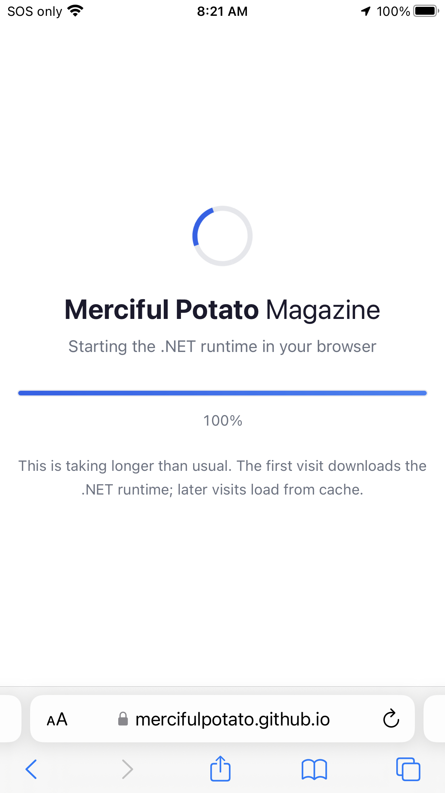
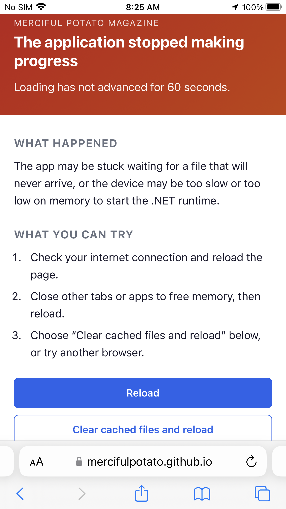
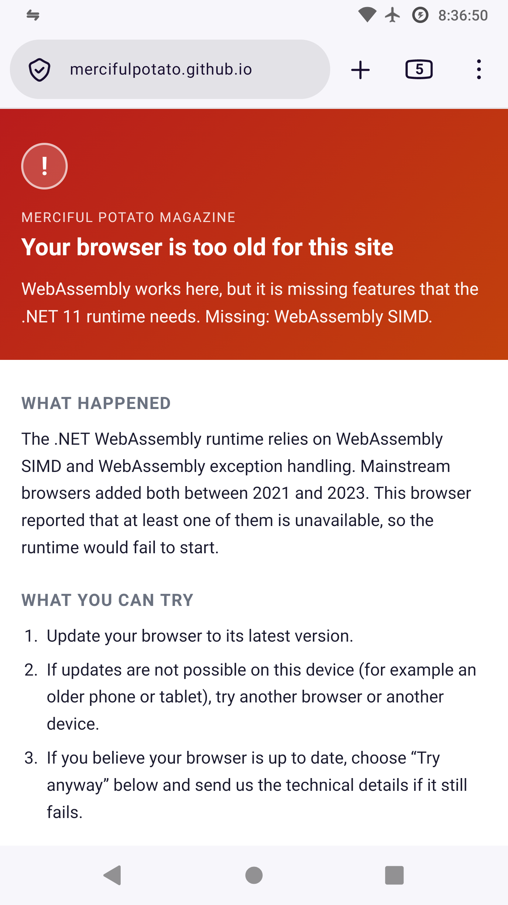
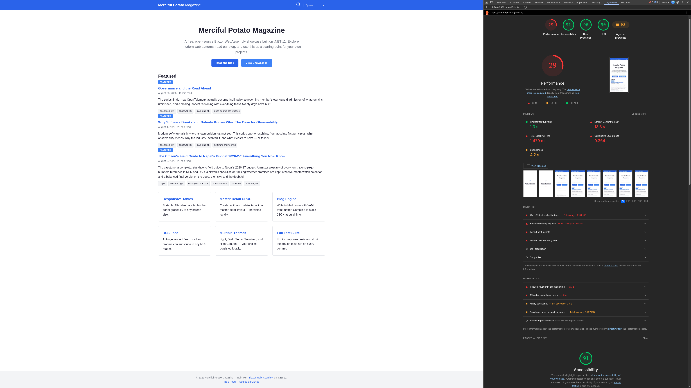

# Merciful Potato Magazine

A free, open-source Blazor WebAssembly application deployed to GitHub Pages.

Built with **.NET 11** (STS) and **C# 15**.

## Features

- **Blog** — Write posts in Markdown with YAML front matter; compiled to static JSON at build time
- **RSS Feed** — Auto-generated `feed.xml`
- **Audio narration** — Every post is narrated with KittenTTS at build time and served as MP3
- **Responsive Tables** — Sortable, filterable data tables that work on mobile
- **Master-Detail Flow** — Click a list item to view full details
- **OpenTelemetry-ready Logging** — Structured logging via `ILogger`
- **Full Test Suite** — bUnit component tests + xUnit.net v3 integration tests, running on Microsoft.Testing.Platform
- **Boot smoke test** — CI serves the published site and verifies it actually starts in headless Chromium
- **Startup diagnostics** — if the app cannot start, visitors see an explanation of what failed and why instead of a frozen loading screen

## Quick Start

```bash
dotnet run --project tools/ObserverMagazine.ContentProcessor
dotnet run --project src/ObserverMagazine.Web
dotnet test
```

## SDK selection

`global.json` pins the minimum SDK to `11.0.100-rc.3.26522.148` with `allowPrerelease: true` and
`rollForward: latestFeature`:

- Locally, a machine that only has the RC3 SDK (for example Fedora's `dotnet-sdk-11.0` package) uses RC3.
- Any machine with a GA `11.0.1xx` SDK installed uses the GA SDK, because it is newer than RC3.
- CI installs the latest GA SDK with `actions/setup-dotnet` (`dotnet-version: 11.0.x`, `dotnet-quality: ga`).
- Both workflows fail fast with "Prerelease SDK ... was selected" if `dotnet --version` reports a prerelease SDK,
  so CI can never silently build with an RC.

Packages reference the GA `11.0.0` ASP.NET Core and Microsoft.Extensions builds in both cases. Once the
GA SDK is available locally, change `sdk.version` to `11.0.100` and remove `allowPrerelease`.

## .NET 11 features used

| Feature | Where |
|---------|-------|
| C# 15 closed hierarchy | `Models/BlogPostView.cs`, consumed by `Pages/BlogPost.razor` |
| C# 15 collection expression arguments (`[with(capacity: n)]`) | `ProductDataGenerator`, ContentProcessor |
| `IHostedService` in Blazor WebAssembly | `Services/AppLifetimeTelemetry.cs` |
| `System.Threading.Lock` | `Services/TelemetryService.cs` |
| Fingerprinted Blazor boot script (`OverrideHtmlAssetPlaceholders`) | `wwwroot/index.html` |
| `dotnet test --timeout` run-level limit | CI workflows |

## Testing

Tests run on **Microsoft.Testing.Platform (MTP)**, not VSTest. The opt-in lives in
`global.json`:

```json
{ "test": { "runner": "Microsoft.Testing.Platform" } }
```

Test projects are ordinary executables, so each one can also be run on its own:

```bash
dotnet test --solution ObserverMagazine.slnx
dotnet test --project tests/ObserverMagazine.Web.Tests
dotnet test --filter-class ObserverMagazine.Web.Tests.Services.BlogServiceTests
dotnet test --filter-trait Category=Integration
dotnet test --timeout 10m
dotnet run --project tests/ObserverMagazine.Integration.Tests
```

The boot smoke test publishes nothing itself; point it at a published `wwwroot`:

```bash
dotnet publish src/ObserverMagazine.Web -c Release -o publish
pip install -r tools/requirements-smoke.txt
python -m playwright install chromium
python tools/boot_smoke_test.py --site-dir publish/wwwroot
python tools/boot_smoke_test.py --site-dir publish/wwwroot --route /blog --route /showcase
```

It serves the folder the way GitHub Pages does (unknown paths return `index.html` with HTTP 404), loads each route
in headless Chromium and fails if the startup error screen or Blazor's error bar appears, or if the page has no
`<h1>` inside `<main>` within the timeout. On failure it prints the boot report and the browser console.

Run `dotnet test -?` from the repo root for the full option list. `DOTNET_TEST_RUNNER=VSTest`
overrides `global.json` for one session.

xUnit configuration for MTP lives in `testconfig.json` next to a test project
(not `xunit.runner.json`, which is the VSTest-era file).

bUnit tests that wait for asynchronous rendering pass an explicit timeout
(bUnit's default is one second, which is too tight on a busy CI runner).

## Startup diagnostics

`wwwroot/index.html` loads `js/boot.js` and then `blazor.webassembly.js` with `autostart="false"`. `boot.js`
starts Blazor itself so it can observe every way startup can fail:

| Detected problem | How it is detected |
|------------------|--------------------|
| No WebAssembly (old browser, Lockdown Mode, Edge enhanced security, policy) | `typeof WebAssembly` before anything downloads |
| WebAssembly too old for .NET 11 | `WebAssembly.validate` probes for SIMD and exception handling |
| Page opened from `file://` | `location.protocol` |
| Loader script missing or blocked | `Blazor` is undefined after `blazor.webassembly.js` |
| Integrity (SRI) failure | Captured console and error messages mention `integrity` or `digest` |
| Download failure | Resource error events, `Failed to fetch`, offline status |
| Crash during startup | `Blazor.start()` rejects, or Blazor shows `#blazor-error-ui` before the first render |
| Stall | `--blazor-load-percentage` has not changed for 60 seconds |

Each case shows a full-page explanation with steps to try, a **Clear cached files and reload** button (clears
Cache Storage and service workers but keeps local settings and data), and a technical report with browser
capabilities and every console error and warning captured during startup. The report can be copied or filed as a
GitHub issue. `window.observerBoot.report()` returns the same text from the browser console.

`boot.js` and `css/boot.css` are deliberately ES5 and plain CSS so that very old browsers can still display the
explanation.

The published `_framework` folder must never be modified after `dotnet publish`. Its files are fingerprinted and
integrity-checked, so editing them (for example stripping `sourceMappingURL` comments) makes browsers refuse to
run the app and it never gets past the loading screen.

## Error handling and logging

- `MainLayout` wraps every page in an `ErrorBoundary`. A page that throws shows an inline error with a
  **Try again** button; the header, navigation and other pages keep working. Navigating recovers automatically.
  The exception is logged by Blazor's `IErrorBoundaryLogger`.
- `GlobalExceptionLogging` logs `AppDomain.UnhandledException` and `TaskScheduler.UnobservedTaskException`.
- Failures are logged at `Warning` or `Error`, never `Debug`, so they are visible at the default `Information`
  level. Nothing in the web app is swallowed by an empty `catch`.
- `AnalyticsService` checks backend health once, logs the outcome, and logs both non-success HTTP status codes and
  exceptions for every call. Analytics problems never break a page.
- `BlogService` logs HTTP failures and invalid JSON as errors and does not cache a failed response, so a transient
  failure does not leave the blog empty for the rest of the session.






iPhone Eight Plus

```
Merciful Potato Magazine startup report
Status: failed
Cause: The application stopped making progress (timeout)
Time: 2026-11-22T13:26:05.586Z
Elapsed: 269.4s
URL: https://mercifulpotato.github.io/
User agent: Mozilla/5.0 (iPhone; CPU iPhone OS 16_7_16 like Mac OS X) AppleWebKit/605.1.15 (KHTML, like Gecko) Version/16.6.2 Mobile/15E148 Safari/604.1
Load progress: 100%

Browser capabilities:
  webAssembly: true
  webAssemblySimd: true
  webAssemblyExceptions: true
  promise: true
  fetch: true
  bigInt: true
  importMaps: true
  localStorage: true
  cacheStorage: true
  secureContext: true
  online: true
  cookiesEnabled: true
  deviceMemoryGb: unknown
  cpuCores: 4
  language: en-US
  viewport: 414x617

Messages captured while loading:
  [0.1s] error: MONO_WASM: Assert failed: This browser/engine doesn't support WASM exception handling. Please use a modern version. See also https://learn.microsoft.com/aspnet/core/blazor/supported-platforms Error: Assert failed: This browser/engine doesn't support WASM exception handling. Please use a modern version. See also https://learn.microsoft.com/aspnet/core/blazor/supported-platforms
  [0.1s] rejection: Error: Assert failed: This browser/engine doesn't support WASM exception handling. Please use a modern version. See also https://learn.microsoft.com/aspnet/core/blazor/supported-platforms
dt@https://mercifulpotato.github.io/_framework/dotnet.runtime.uyfhwbfd13.js:3:19357
Nc@https://mercifulpotato.github.io/_framework/dotnet.runtime.uyfhwbfd13.js:3:181347
setup@https://mercifulpotato.github.io/_framework/dotnet.native.gyn70opcq7.js:1:8676
@https://mercifulpotato.github.io/_framework/dotnet.native.gyn70opcq7.js:1:93518
createDotnetRuntime@https://mercifulpotato.github.io/_framework/dotnet.native.gyn70opcq7.js:1:50
@https://mercifulpotato.github.io/_framework/dotnet.geuw83fa10.js:4:30757
  [0.2s] rejection: CompileError: WebAssembly.Module doesn't parse at byte 1283: can't get 1th Type's return value
```

Nexus 6
```
Merciful Potato Magazine startup report
Status: failed
Cause: Your browser is too old for this site (oldWebAssembly)
Time: 2026-11-22T13:35:23.315Z
Elapsed: 10.0s
URL: https://mercifulpotato.github.io/
User agent: Mozilla/5.0 (Android 11; Mobile; rv:162.0) Gecko/162.0 Firefox/162.0
Load progress: not reported

Browser capabilities:
  webAssembly: true
  webAssemblySimd: false
  webAssemblyExceptions: true
  promise: true
  fetch: true
  bigInt: true
  importMaps: true
  localStorage: true
  cacheStorage: true
  secureContext: true
  online: true
  cookiesEnabled: true
  deviceMemoryGb: unknown
  cpuCores: 4
  language: en-US
  viewport: 480x695

Messages captured while loading:
  [0.1s] warn: Missing browser features: WebAssembly SIMD
```  

## Audio narration

`tools/generate_audio.py` turns each post into `blog-data/<slug>.mp3`. Posts without
an MP3 simply hide the audio player.

The work is incremental. Each finished post is recorded in `audio-manifest.json`
using a hash of the post body (front matter excluded), voice, model, speed and
`PIPELINE_VERSION`. Bump `PIPELINE_VERSION` to force regeneration after changing
text preprocessing.

In CI (`deploy.yml`):

- Posts are split across 4 parallel runners by a stable hash of the slug.
- Each runner restores its own cache and generates only what is missing or changed.
- Each runner stops starting new posts after 270 minutes.
- The cache is saved even when the job fails, so the next run resumes where this one stopped.
- The site deploys with whatever audio exists.
- When nothing is pending, the Python toolchain is never installed.

Locally:

```bash
pip install -r tools/requirements-audio.txt
sudo apt-get install -y espeak-ng ffmpeg
python tools/generate_audio.py --check
python tools/generate_audio.py
python tools/generate_audio.py --shard 0 --shards 4 --output-dir tts-cache/shard-0 --time-budget-minutes 60
```

Published GitHub Pages sites may be no larger than 1 GB. The deploy job prints the
site size and warns above 900 MB.

## Technology

| Component | Technology | License |
|-----------|-----------|---------|
| Framework | .NET 11 / Blazor WASM 11.0.0 | MIT |
| Markdown | Markdig 1.6.0 | BSD-2-Clause |
| YAML | YamlDotNet 18.1.0 | MIT |
| Test framework | xUnit.net v3 4.0.3 | Apache-2.0 |
| Component testing | bUnit 2.15.2 | MIT |
| Test runner | Microsoft.Testing.Platform v2 | MIT |
| Text-to-speech | KittenTTS 0.8.1 | Apache-2.0 |
| Boot smoke test | Playwright for Python 1.63.0 | Apache-2.0 |

All dependencies are free for any use — no payment required, ever.

## License

AGPLv3
